# VQ-VAE + PixelCNN for Synthetic HipMRI Prostate Slices

**Author:** Kenan Chu (s4641359) · COMP3710 Pattern Analysis Project 2026 · Difficulty: **Hard** (VQ-VAE, Section 2.4)

## 1. Overview

### Problem
Medical imaging research is limited mainly by patient privacy laws and by the small number of available scans. Generative models could produce synthetic scans that are shared or used for data augmentation in place of real patient data. However, a generative model for medical data faces three risks: (1) blurry or mode-collapsed samples that lack variety, (2) hallucinated anatomy that could teach downstream models incorrect features, and (3) memorisation of training scans, which would leak real patients’ data if it were shared. This project builds a VQ-VAE with a PixelCNN prior to generate synthetic 2D pelvic MRI slices from the HipMRI prostate cancer study, and evaluates it against all three risks for a research team considering sharing synthetic data.

### How it works
The VQ-VAE encoder compresses each 256 x 128 slice to a 64 x 32 grid of vectors. Each vector is replaced by its nearest entry in a codebook of 512 vectors, which turns the slice into a grid of discrete codes and a decoder reconstructs the slice from these codes. Since the nearest-code step is not differentiable, gradients are copied straight past it and the two extra loss terms pull the codebook and encoder outputs towards each other. To generate new slices, a PixelCNN prior is trained on the code grids of the training set: it predicts each code from the codes above and to its left, so new grids can be sampled one code at a time and decoded into new slices.

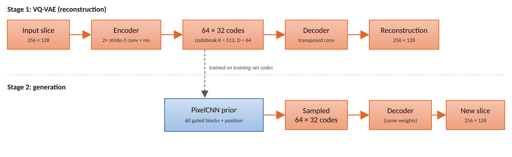 
*Figure 1: Two-stage pipeline. Stage 1 trains the VQ-VAE; stage 2 trains a PixelCNN prior on the code grids, then samples new grids and decodes them into new slices.*

### Key results
- Reconstruction: test SSIM 0.917 vs 0.506 for a VAE baseline, with 16× fewer parameters.
- Generation: Inception FID 234 vs 421 for the VAE, and sample diversity (0.272) close to real slices (0.225).
- Privacy: no evidence of memorisation: generated slices are less similar to the training set than unseen real slices, and the closest sample (0.478 SSIM) is far below near-copies (≈0.91+).
- Verdict: privacy-safe by this audit, but samples are not yet anatomically reliable enough for downstream training (Section 6).

## 2. Feasibility Review

> The one-page review below is included unchanged from the version checked off on 27 October 2026. Results since then are in Sections 5 and 6.

*VQ-VAE for Synthetic Prostate MRI (HipMRI 2D) · Kenan Chu (s4641359) · 25 October 2026*


#### 1. User need, scope and acceptance criteria

**User:** a data manager in a prostate radiotherapy research group who wants to share or augment HipMRI pelvic MRI slices without exposing real patients' scans.

**Prototype purpose:** generate novel synthetic 2D pelvic MRI slices with a VQ-VAE, then test the domain dilemma: are the samples realistic, or blurry, hallucinated, or memorised copies of training patients?

**Acceptance criteria:**

1. **Fidelity:** mean SSIM > 0.6 between VQ-VAE reconstructions and held-out test slices.
2. **Beats baseline:** VQ-VAE achieves higher SSIM and lower FID than a convolutional VAE baseline on the same test split.
3. **No memorisation:** for 100 uncurated generated samples, the nearest-training-neighbour distance is not smaller than that of real test slices to the training set.
4. **Plausibility:** an uncurated 8×8 sample grid shows recognisable pelvic anatomy; 3–5 failure cases are diagnosed.
5. **Resources:** peak training VRAM ≤ 8 GB, VQ-VAE + prior training ≤ 2 h on one GPU, 100 samples generated in < 5 min.

#### 2. Model choice and course concepts

**Difficulty:** Hard (VQ-VAE, Section 2.4).

**Dataset:** HipMRI 2D slices (`/home/groups/comp3710/HipMRI_Study_open/keras_slices_data`), using the provided train / validate / test folders. Case IDs in filenames confirm no patient appears in two splits. Slices are loaded with nibabel (Appendix B) and min-max scaled to \[0, 1\].

**Main model: VQ-VAE** (van den Oord et al., 2017):

- CNN encoder (4× downsampling) → codebook of K = 512 vectors (D = 64) → CNN decoder.
- Loss = reconstruction + codebook loss + β·commitment loss (β = 0.25), with a straight-through gradient past quantisation.
- A small gated PixelCNN prior over the code grid is trained afterwards to sample new images.

**Baseline:** a convolutional VAE of similar encoder/decoder size, trained and evaluated on the same splits.

**Why this choice:** discrete latents avoid the blurry outputs of a Gaussian VAE, and the 2D slices are small enough to train in under an hour. The codebook lookup is nearest-neighbour vector quantisation (k-means style), linking to course content on autoencoders, latent representations, CNNs, clustering, and SSIM.

#### 3. Preliminary feasibility evidence

All runs on a laptop RTX 2050 (4 GB), 26 Oct.

**Data audit:** 11,460 / 660 / 540 slices from 31 / 4 / 3 patients (train / validate / test), with no patient overlap. Slices are 256×128 (60 train slices at 256×144 are resized). Raw intensities vary by scan (max 592–1212), so each slice is scaled to \[0, 1\].

| Run | Test SSIM | Params | Peak VRAM | Time/epoch |
| --- | --- | --- | --- | --- |
| VAE baseline, 20 epochs | 0.506 | 13.45 M | 0.47 GB | 48 s |
| VQ-VAE, 15 epochs (64×32 codes) | **0.917** | 0.86 M | 0.67 GB | 113 s |
| PixelCNN prior, 3 epochs | 5.1 bits/code (vs 9 uniform) | 4.07 M | 1.80 GB | 420 s |

**Takeaway:** the VQ-VAE already meets the fidelity target and beats the baseline with 16× fewer parameters; codebook perplexity of about 390 of 512 shows no collapse. The VAE plateaus near SSIM 0.46 on validation from epoch 10. Early prior samples have realistic local tissue texture but no coherent global anatomy (horizontal streaks, no body outline): a known limit of a single-stack PixelCNN on a large 64×32 code grid.

#### 4. Risks, budget and fallback

| Risk | Mitigation |
| --- | --- |
| Codebook collapse (few codes used) | Track perplexity; reset dead codes. Observed: perplexity about 390 of 512 |
| PixelCNN samples incoherent (observed) | Smaller 32×16 code grid; train longer; two-stack Gated PixelCNN to remove the blind spot; lower sampling temperature |
| Rangpur queue delays (observed: about 14 h estimated wait) | Develop and train on laptop GPU; Rangpur or Colab only for long runs |
| Short timeline (due 30 Oct) | Baseline first, then VQ-VAE, then prior; commit at each milestone |

**Compute budget:** a laptop RTX 2050 (4 GB) for development and runs of about 20 min; Rangpur `comp3710` A100 (queue wait of hours this week) or Colab for longer runs. Estimated about 20 min VAE baseline, 1 h VQ-VAE, 1 h PixelCNN prior.

**Next experiment:** retrain the VQ-VAE with a larger grid and train the prior for 15 epochs, testing whether a smaller grid gives more coherent anatomy at a small cost in reconstruction SSIM. Then run the memorisation audit (nearest training neighbours) and failure analysis.

**Fallback:** if the PixelCNN prior fails, deliver the VQ-VAE with reconstruction SSIM, latent interpolation, and the memorisation audit on decoded codes. If the VQ-VAE fails, the VAE baseline becomes the working deliverable.

**Since this review:** I tested the smaller 32×16 grid (fewer streaks but blurrier, SSIM fell to 0.778), so I kept 64×32. A 60-block prior with a learned position embedding removed the horizontal bands. I then ran the temperature sweep, the memorisation audit and the VAE vs VQ-VAE evaluation (Sections 5 and 6).

## 3. Data and Pre-processing

### Dataset
This project uses the 2D slices from the HipMRI prostate cancer study provided for the course (`keras_slices_data` on Rangpur). Each slice is a 256×128 greyscale pelvic MRI stored in Nifti format and loaded with nibabel. Each filename contains the patient's case number, scan week and slice number. I used only the image slices; the segmentation masks were not needed for this task.

### Pre-processing
Raw intensities vary between scans (maximum raw intensities differ between splits, from 592 to 1212), so a single global scale would make some scans darker than others. Each slice was therefore min-max scaled to [0, 1] individually. 60 training slices were stored at 256×144 and were resized to 256×128 with bilinear interpolation so that all slices share one shape. No data augmentation was used: flips or rotations would show the model incorrect anatomical layouts (such as mirrored organ positions), which would harm the plausibility of generated anatomy. An intensity-jitter option is implemented in `dataset.py` but was not enabled, since per-slice normalisation already removes scan-to-scan intensity differences, the main variation that intensity jitter would simulate.

### Splits and justification

| Split | Slices | Patients |
|---|---|---|
| Train | 11,460 | 31 |
| Validate | 660 | 4 |
| Test | 540 | 3 |

I kept the provided train/validate/test split, which is already split by patient. Splitting by slice instead would let near-duplicates of training slices (neighbouring slices and repeated weekly scans of the same patient) appear in the test set, inflating test scores. The split was verified with the data audit in `dataset.py`, which extracts case IDs from the filenames and found no patient in more than one split. However, the test set is unbalanced: patient 040 has seven weekly scans, making up 420 of the 540 test slices, so test metrics mostly reflect one patient. This is why per-patient results are reported in Section 5.

## 4. Method

### Baseline: convolutional VAE
The baseline is a convolutional VAE that has four stride-2 convolutions, which reduce a slice to a 16 x 8 feature map. Fully connected layers map this to the mean and variance of a Gaussian latent. A mirrored decoder of transposed convolutions reconstructs the slice. It is trained with summed MSE reconstruction loss plus the KL divergence (weight 1), and uses the latent mean at evaluation for deterministic reconstructions. This is a fair baseline because it is the standard generative autoencoder and is trained and evaluated on identical data, splits and metrics. Most of its 13.45M parameters are in the fully connected layers.

### VQ-VAE
The encoder uses two stride-2 4 x 4 convolutions (64 then 128 channels) to downsample 256 x 128 slices to 64 x 32, followed by a 3 x 3 convolution and two residual blocks (3 x 3 then a 1 x 1 convolution) and a 1 x 1 convolution to 64 dimensional vectors. The decoder mirrors this with transposed convolutions and a sigmoid output. Each vector is quantised to its nearest codebook entry (K = 512, D = 64), and the loss is reconstruction MSE plus a codebook loss and a commitment loss weighted by β = 0.25. The vector quantiser is adapted from the COMP3710 VQ-VAE MNIST demo, with two additions: codebook perplexity tracking, and resetting rarely used (“dead”) codes to random encoder outputs every 200 steps, which prevents codebook collapse. 

The design choices were based on the CNN principles from lecture 7: stride-2 convolutions downsample instead of pooling, channels increase as spatial size shrinks, and weight sharing keeps the model small (0.86M parameters). Keeping a spatial grid of codes, rather than a single vector, preserves local detail.

### PixelCNN prior
The prior models the distribution of code grids from the trained VQ-VAE. Each code is embedded into a vector, then passed through a 7 x 7 mask-A convolution (cannot see the current position) and N gated residual blocks. Each block contains a 3 x 3 mask-B convolution where its output is split into tanh and sigmoid halves, multiplied and passed through a 1 x 1 convolution. A 1 x 1 head outputs 512 logits per position. Since each 3 x 3 block extends the view by one row, the prior gets to see 3 + N rows above each position and parameters grow with the square of the width but only linearly with depth. An optional learned row and column position embedding is added to the code embeddings, so the prior knows where in the slice it is generating (Section 6). New slices are generated by sampling codes one at a time in raster order, at temperature T, and decoding the grid. A known limitation of this single-stack design is its blind spot: it can never see the region above and to the right of each position.

### Final configuration and hyperparameters

| Model | Grid | Epochs | Batch | LR | Other |
|---|---|---|---|---|---|
| VAE baseline | - | 20 | 32 | 1e-3 | latent 256, KL weight 1 |
| VQ-VAE (main) | 64x32 | 15 | 32 | 2e-4 | K 512, D 64, beta 0.25 |
| VQ-VAE (ablation) | 32x16 | 12 | 32 | 2e-4 | n_down 3 |
| PixelCNN prior (final) | 64x32 | 10 (best 8) | 32 | 1e-3 | 64 ch, 60 blocks, position embedding, T = 1.0 |

All models use batch size 32 (to fit 4 GB of laptop VRAM) and seed 42, with the best checkpoint chosen on validation (SSIM for the autoencoders, cross-entropy for priors). K = 512, D = 64 and β = 0.25 are standard values from the VQ-VAE paper. The codebook perplexity of around 386 out of 512 indicates that the codebook is used well and shows no sign of collapse. The 64×32 grid (two downsampling steps) was chosen over 32×16 by experiment, since it reconstructs at SSIM 0.917 vs 0.778. The VQ-VAE uses a lower learning rate (2e-4) than the VAE and prior (1e-3) for stable codebook training. The final prior configuration (64 channels, 60 blocks, position embedding, T = 1.0) was chosen through the experiments in Section 6.

## 5. Results

### Training
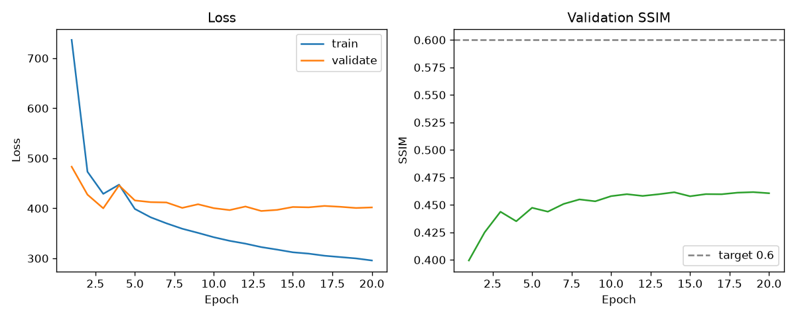
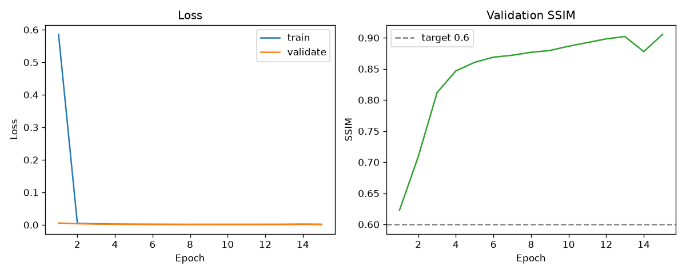
*Training and validation loss (left) and validation SSIM (right) for the VAE baseline (top) and the VQ-VAE (bottom).*

The VAE baseline's validation SSIM rose from 0.40 to 0.46 within the first 10 epochs and then plateaued, while its training loss kept falling. The plateau reflects the limit of a single Gaussian latent, and the widening gap between training and validation loss suggests some overfitting. The VQ-VAE passed the 0.6 target after one epoch and reached a validation SSIM of 0.905 by epoch 15. Its codebook perplexity rose from about 170 to around 400 of 512 during training, meaning most codes were in use and the codebook did not collapse. Validation SSIM was still rising at epoch 15, so longer training might improve reconstruction further.

### Reconstruction: baseline vs VQ-VAE (identical test split)

| Model | Test SSIM | Params | Codebook perplexity |
|---|---|---|---|
| VAE baseline | 0.506 | 13.45 M | - |
| VQ-VAE 64x32 | **0.917** | 0.86 M | ~386 / 512 |
| VQ-VAE 32x16 | 0.778 | 0.99 M | ~419 / 512 |

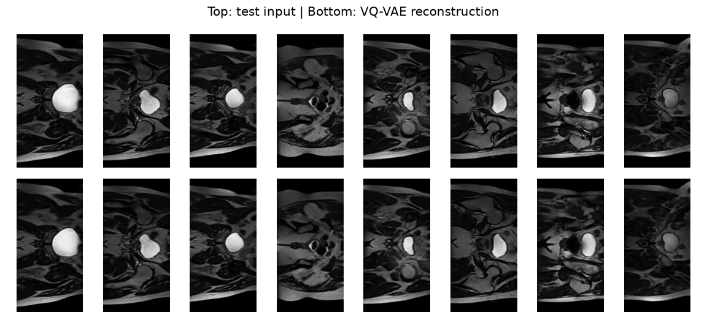
*Test slices (top) and VQ-VAE 64×32 reconstructions (bottom).*

The VQ-VAE reconstructed test slices with a mean SSIM of 0.917, compared with 0.506 for the VAE, while using far fewer parameters. Most of the VAE's parameters are in its fully connected layers, whereas the VQ-VAE is fully convolutional, so weight sharing keeps it small. The VAE compresses each slice into a single continuous latent vector (256 numbers) and averages over uncertainty, which causes blurry reconstructions. Instead of forcing the image through one vector, the VQ-VAE keeps a 64×32 grid of discrete codes, so spatial detail is preserved. Reducing the grid to 32×16 lowers reconstruction SSIM to 0.778 but slightly increases the parameter count, because the extra downsampling step adds one convolution layer to both the encoder and decoder. Its higher perplexity is likely because each code covers a larger 8×8 patch with more varied content, so more distinct codes are needed. Both perplexities indicate a healthy codebook.

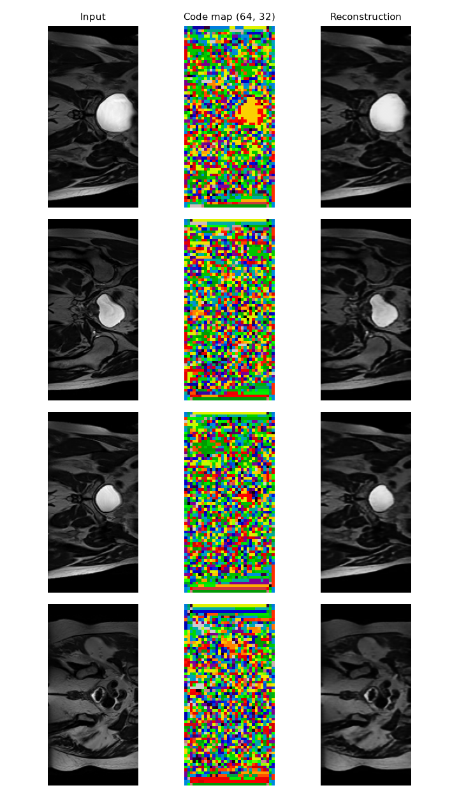
*Input, code-index map and reconstruction for four test slices.*

The colours in the code maps have no ordering, since code numbers are arbitrary. The meaningful pattern is that uniform regions, such as the bladder and the background, are represented by a single repeated code, indicating that the codebook has learned reusable tissue patterns.

### Per-slice and per-patient analysis

| Test patient | Slices | Mean SSIM (64x32) | Mean SSIM (32x16) |
|---|---|---|---|
| 040 | 420 | 0.920 | 0.781 |
| 041 | 60 | 0.915 | 0.773 |
| 042 | 60 | 0.904 | 0.759 |

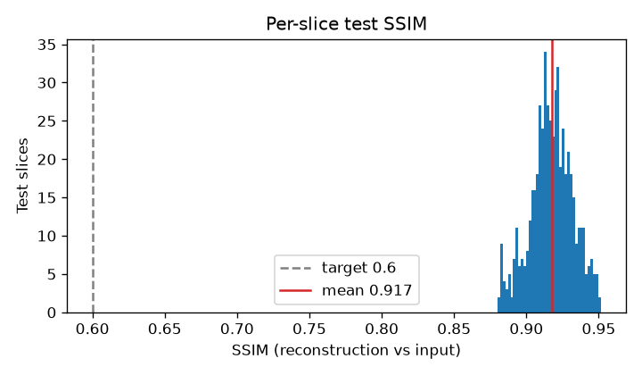
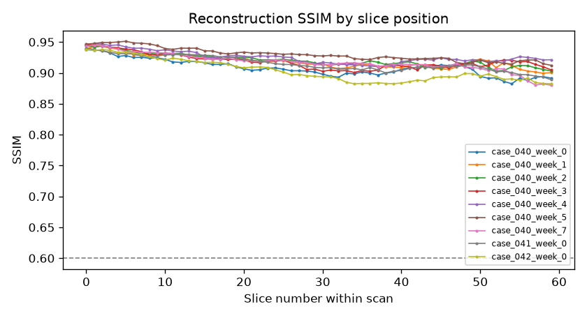

All 540 test slices were reconstructed with SSIM between 0.880 and 0.951, so the model never comes close to failing the 0.6 target. Along each scan, SSIM declines steadily from about 0.94 at the first slices to about 0.89 at the last.

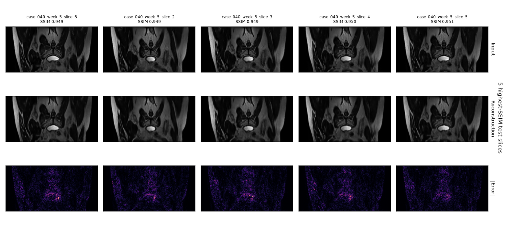
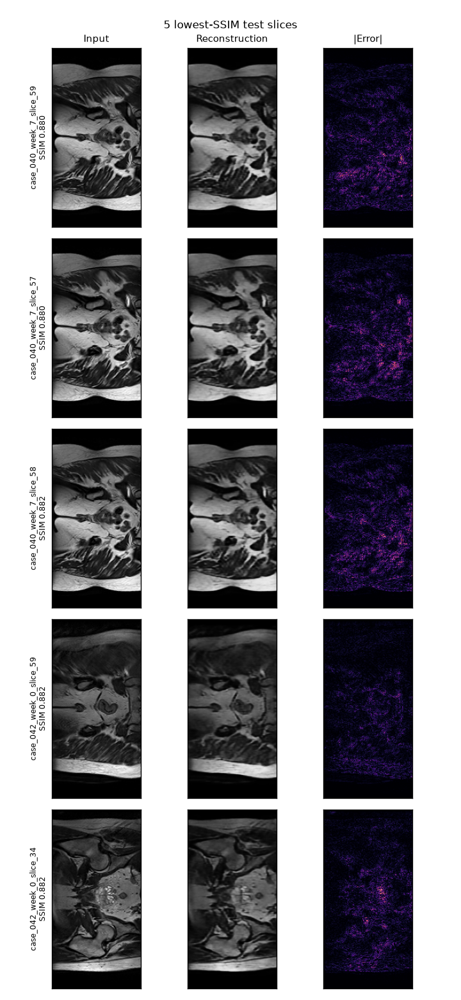
*Highest- and lowest-SSIM test slices: input, reconstruction and absolute error.*

The best slices contain large smooth regions with plenty of background and a bright bladder, while the worst contain dense muscle, bowel and bone texture, where the error concentrates. Since each code represents a 4×4 pixel patch, fine high-frequency texture is slightly smoothed. Patient 042 has the lowest mean SSIM in both the 64×32 (0.904) and 32×16 (0.759) models, so its scan appears genuinely harder rather than this being a quirk of one model.

### Generation: baseline vs VQ-VAE

| Slices | FID (Inception) ↓ | FD (VQ-VAE features) ↓ | Diversity: mean pairwise SSIM ↓ | NN-SSIM to train (mean / max) |
|---|---|---|---|---|
| VAE baseline samples | 420.7 | 0.17 | 0.519 | 0.436 / 0.542 |
| VQ-VAE + prior samples | **234.0** | 0.04 | **0.272** | 0.344 / 0.478 |
| Real train slices (reference) | 77.4 | 0.02 | 0.225 | n/a |
| VQ-VAE reconstructions of train (reference) | 108.8 | 0.01 | 0.250 | 0.908 / 0.949 |

*300 uncurated slices per group; FID and FD computed against all 540 real test slices; prior temperature 1.0.*

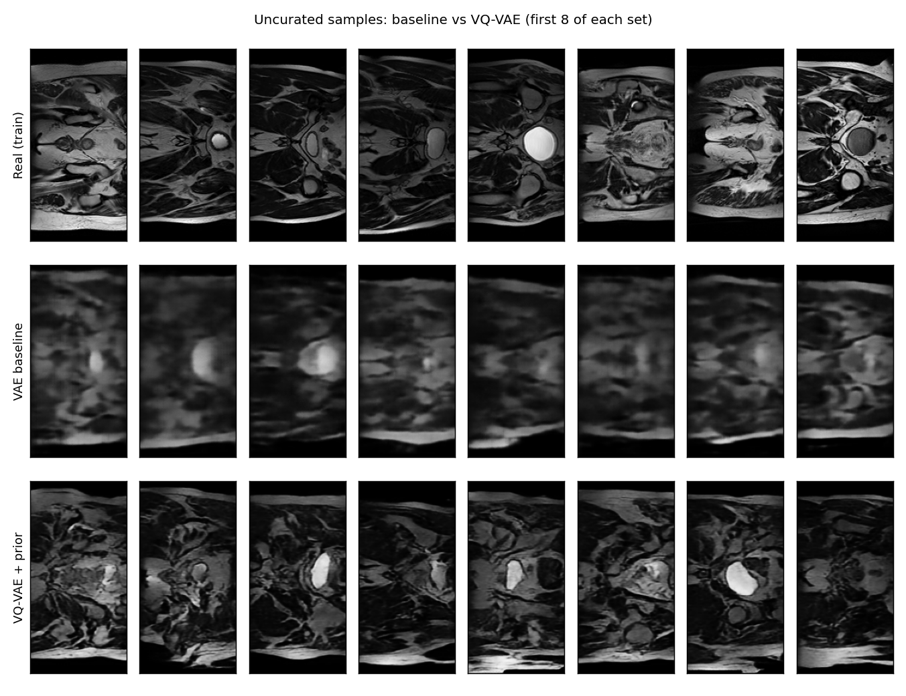
*Uncurated samples from the VAE baseline and the VQ-VAE + PixelCNN prior, with real slices for reference.*

300 uncurated samples from each model were compared against the 540 real test slices. The VQ-VAE's Inception FID is 44% lower than the VAE's (234.0 vs 420.7), meaning its samples are closer to the real distribution, although still well above real training slices (77.4). Even VQ-VAE reconstructions of real slices score 108.8, so part of the gap to real slices comes from the decoder itself, not the prior. Diversity, measured as the mean SSIM between pairs of samples within a set (lower means more varied), is 0.272 for the VQ-VAE, close to real slices (0.225), while VAE samples are about twice as similar to each other (0.519), reflecting their blurry, averaged appearance: mode-collapse-like behaviour. VAE samples also have a higher nearest-neighbour SSIM to the training set (0.436 vs 0.344), but this reflects blur towards an "average slice" rather than copying, so this metric must be read alongside diversity. Inception was trained on natural photographs, so absolute FID values are not directly meaningful for MRI; I therefore use it only to rank models evaluated the same way. This ranking agrees with the VQ-VAE-feature distance and the visual comparison, which supports it. Finally, the VQ-VAE-feature distance uses the VQ-VAE's own encoder, so it naturally favours VQ-VAE outputs.

### Resource profiling

| Model / task | Params | Peak VRAM | Time | Hardware |
|---|---|---|---|---|
| VAE baseline | 13.45 M | 0.47 GB | 48 s / epoch | RTX 2050 (laptop, 4 GB) |
| VQ-VAE 64x32 | 0.86 M | 0.67 GB | 113 s / epoch | RTX 2050 |
| VQ-VAE 32x16 | 0.99 M | 0.39 GB | 60 s / epoch | RTX 2050 |
| PixelCNN 32x16, 24 blocks + pos | 2.15 M | 0.53 GB | ~38 s / epoch; 64 samples in 18 s | RTX 2050 |
| **PixelCNN 64x32, 60 blocks + pos (final)** | 4.96 M | 4.26 GB | 92 s / epoch; 100 samples in 76 s | Colab A100 |
| Audit NN search (300 x 11,460 SSIM pairs) | - | - | 16 s | Colab A100 |

The baseline, both VQ-VAEs and the 32×16 priors were trained on a laptop RTX 2050 (4 GB). The 60-block prior required more than 4 GB of VRAM, so it was trained on a Google Colab A100, where each epoch took 92 s and 100 samples took 76 s. Because the PixelCNN generates the 2,048 codes of each slice one at a time, each sample needs 2,048 forward passes (about 0.8 s per slice on the A100), so generation cost grows with grid size. The memorisation audit's nearest-neighbour search (300 slices against 11,460 training slices) took only 16 s on the A100. Running `predict.py` on the laptop and on the A100 gave identical test SSIM (0.9174), showing that results are reproducible across hardware.

## 6. Engineering Dilemma Investigation
 
### Improving the prior: a sequence of diagnosed fixes

Each step below changed one thing, chosen by diagnosing the previous result. The table summarises steps 1–6; step 7 tests sampling temperature.

| Step | Prior | Rows visible | Test bits/code | What the samples showed |
|---|---|---|---|---|
| 1 | 64x32, 10 blocks | 13 / 64 | 5.11 | Horizontal streaks, no global layout |
| 2 | 32x16, 10 blocks | 13 / 32 | 5.84* | More coherent, blurrier |
| 3 | 32x16, 24 blocks | 27 / 32 | 5.76* | Bladder more often central, fewer bands |
| 4 | 64x32, 60 blocks | 63 / 64 | 4.90 | Better likelihood but worse samples (bands) |
| 5 | 32x16, 24 blocks + position | 27 / 32 | 5.71* | Bands gone, consistent body outline |
| 6 | **64x32, 60 blocks + position** | 63 / 64 | **4.88** | Sharp, plausible layout (bladder, ring, round structures) |

*\* 32×16 bits/code are not directly comparable with 64×32 (each code covers 4× more pixels).*

**Step 1: Limited reach (64×32, 10 blocks).** The first iteration of the prior showed realistic local tissue texture, but there were horizontal streaks and no body outline. The problem was that the prior's reach was too small for the MRI slices. The first layer is a 7×7 mask-A convolution (3 rows of reach) and each block adds a 3×3 mask-B convolution (1 more row), so the prior sees 3 + N rows. With 10 blocks that is only 13 of 64 code rows. As a result, samples had realistic local texture but no coherent body structure: lower rows had no connection with the upper rows, patterns continued sideways as horizontal streaks, and larger structures appeared partially formed, misplaced or lacking symmetry.

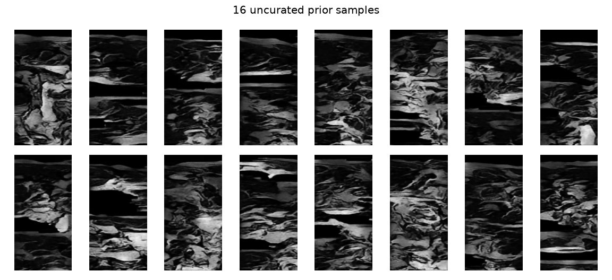

**Step 2: Coarser grid (32×16, 10 blocks).** As a first test, I switched to the 32×16 grid, where the same 13 rows cover 13 of 32. Samples became more coherent (a consistent top edge and a central bright organ), confirming that reach was the issue. However, they were blurrier, because of the 32×16 grid: the 32×16 VQ-VAE reconstructs at SSIM 0.778 vs 0.917 for 64×32.

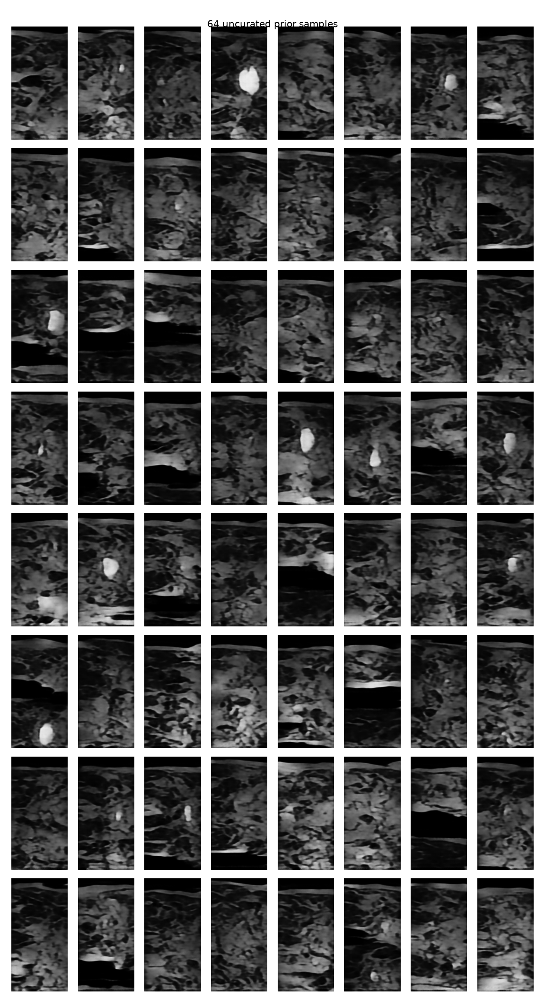

**Step 3: Deeper, thinner prior (32×16, 24 blocks).** The next fix was to increase the depth (number of blocks) while reducing the channel width. Since parameters grow with the square of the width but only linearly with depth, I halved the width (128 → 64 channels) and increased depth (10 → 24 blocks). The receptive field doubled from 13 to 27 rows with half the parameters (4.07M → 2.14M); the prior also trained faster per epoch and overfit less (the best validation epoch moved from 4 to 6). The samples were more coherent: a more consistent top edge, fewer bands, and a body outline starting to form. The bright organ (most likely the bladder) also appeared more often than in step 2 (in about 25 vs 13 of 64 samples).

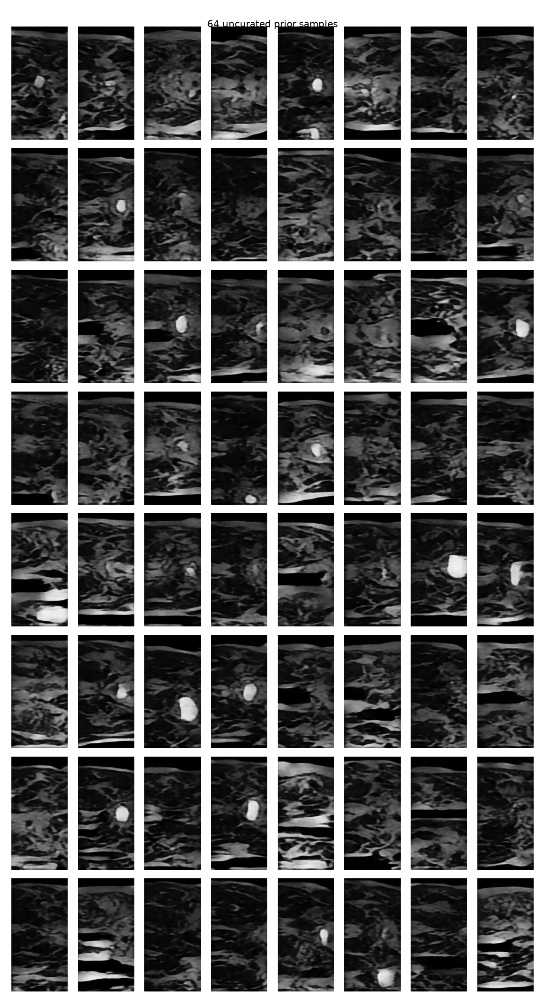

**Step 4: Full-height prior (64×32, 60 blocks).** Since a larger receptive field improved coherence on the 32×16 grid, I applied the same fix to the sharper 64×32 grid, increasing the prior to 60 blocks so it could see 63 of 64 rows. This was trained on a Google Colab A100 instead of my laptop, since it needed more than 4 GB of VRAM. It gave the best test likelihood so far (4.90 bits per code), meaning it predicted unseen code grids best. However, it produced the worst-looking samples: sharp textures, but many horizontal black bands, an unrecognisable body outline, and a bladder in only 3 of 64 samples. Seeing the whole image was not enough, and a better likelihood does not guarantee better samples, so receptive field was necessary but not sufficient.

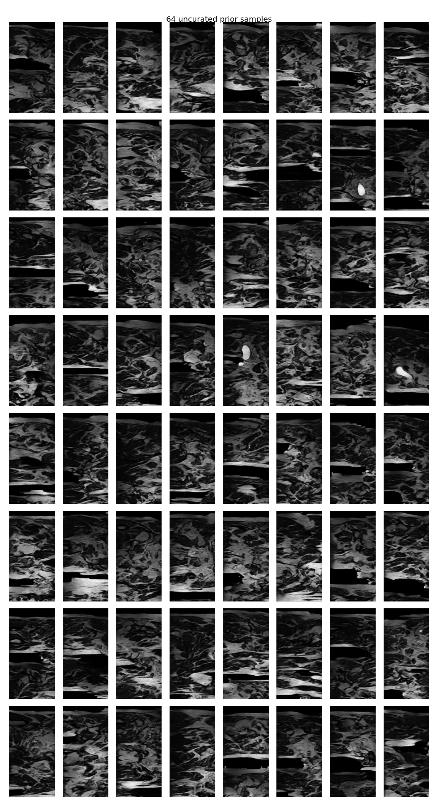

**Step 5: Position embedding (32×16, 24 blocks).** The black bands persisted even at full receptive field, so the reach was not the cause. The bands also ran sideways across whole rows, which matches how the prior generates codes row by row. In the MRI slices, the background spans whole rows at the top and bottom edges, so background to the left predicts background at the current position. Without position information, a background code anywhere in the image continues across the row, and then into the following rows, since the prior now sees background above and to the left, forming horizontal bands. This led to the conclusion that the prior had no idea where in the image it was. This is a consequence of convolution's design: convolutions share the same weights at every position, which gives translation equivariance, a useful bias when a pattern can appear anywhere in an image. HipMRI slices are different: they are spatially aligned, so position predicts content well (background around the edges, organs near the centre). Here, translation equivariance removes information the prior needs. Transformers face the same issue, since attention is unaware of input order, and it is usually solved by adding positional encodings to their inputs. I applied the same idea: a learned row vector and column vector are added to each code's embedding before the first masked convolution. For the code at row x, column y, the input becomes embedding(code) + row(x) + col(y), adding around 8k parameters. Because it depends only on coordinates and never on code values, it does not let the prior see future codes. To isolate its effect, I first added it to the 32×16, 24-block prior with every other setting unchanged. The bands disappeared, every sample gained a consistent body outline with a central bladder, and validation loss improved slightly (4.256 → 4.231).

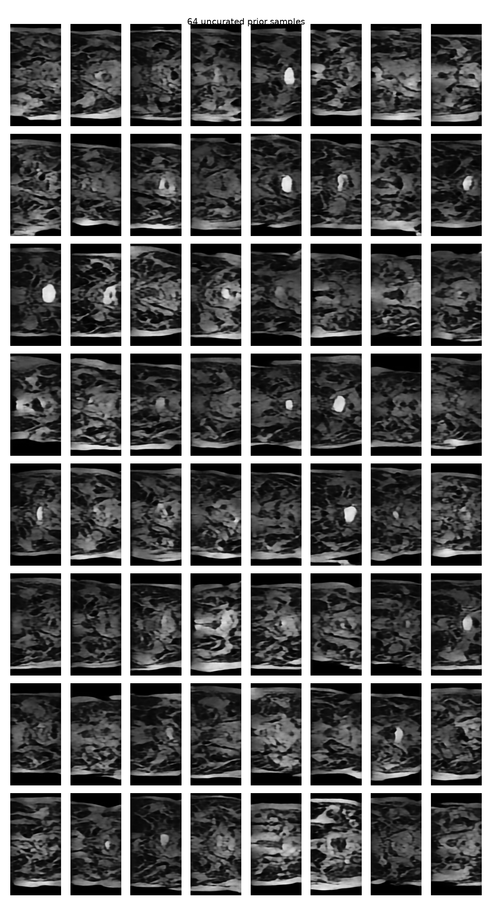

**Step 6: Final model (64×32, 60 blocks + position).** For the final model, I combined depth and position embedding on the 64×32 grid, since the two fixes cover each other's weaknesses. Depth lets the prior coordinate structures across the whole slice, but without coordinates it got lost and produced horizontal black bands. Position embedding tells it which row and column it is generating, so it knows what belongs there, but it had only been tested on the blurrier 32×16 grid. The final samples showed sharper detail and a more coherent body layout: a bright organ with a dark ring around it, a dark round structure below it, sometimes round structures on the sides, and a consistent body outline without black bands. It also achieved the best likelihood overall (4.88 bits per code, val CE 3.653). Several problems remained: half-formed or ambiguous organs, smeared regions, no clear bones, and areas that don't make anatomical sense. These could be caused by the PixelCNN's blind spot: it cannot see certain regions no matter how many layers are added, so structures there cannot be coordinated. Both fixes addressed problems of configuration, but neither changes the PixelCNN's architecture, so its limitations remain: the blind spot at each position, the local bias of convolutions, and errors that compound over long sequences of decisions. The remaining problems are consistent with these limits, which motivate the future work in Section 7.

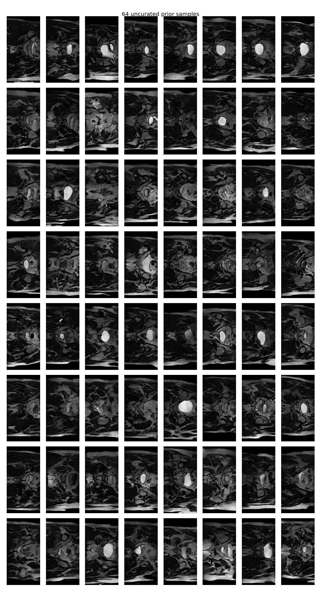

**Step 7: Sampling temperature.** Before concluding that the problems came from the architecture, I tested whether they came from sampling rather than from what the prior learned. At T = 1.0, the prior occasionally draws rare, low-probability codes, which I hypothesised might produce the smeared patches. Lowering the sampling temperature suppresses these codes without retraining, so it isolates sampling as a cause. At each position, the prior gives a score for each code; before picking one, the scores are divided by T and turned into probabilities. T = 1.0 samples exactly as the model learned, while T < 1 sharpens the probabilities, so the most likely codes become even more likely and rare codes are almost never picked. I compared T = 1.0 with T = 0.8 and 0.7. At T = 0.8, samples were darker, with less tissue texture and more samples looking alike; at T = 0.7, many slices were nearly empty and dark, with large bright blobs. The most common codes in real slices are background and dark tissue, so lower T pushed the prior towards those, making samples darker and less detailed. The bright blobs arise when the prior starts a bright region: at low T, the most likely next code is more of that region, so it keeps choosing it and the area grows too large. My hypothesis that sampling caused the problems did not hold. The rarer codes actually carry the tissue detail, so removing them made things worse. The remaining problems come from what the prior learned, not from sampling randomness, so T = 1.0 was kept.

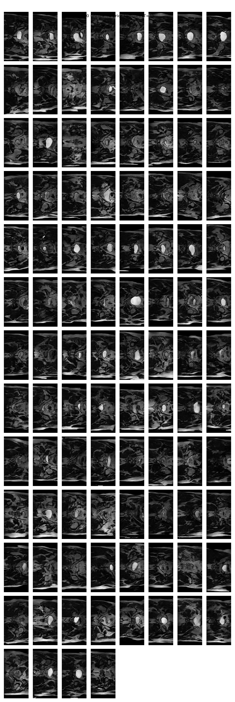
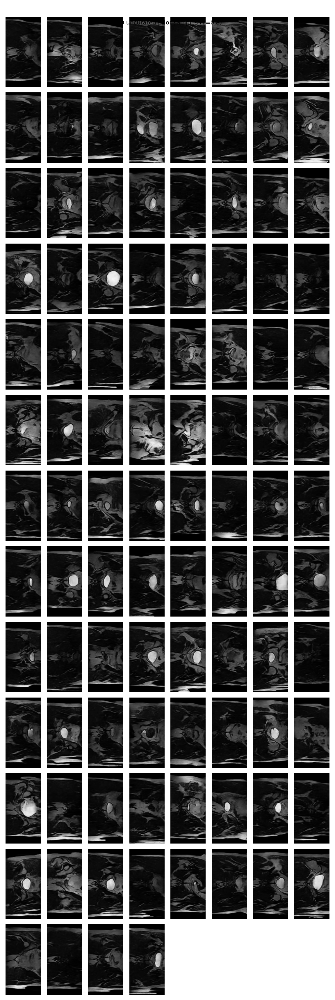
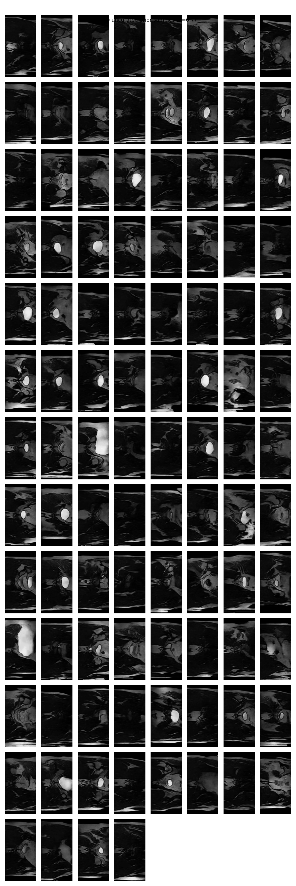
 
### Memorisation audit
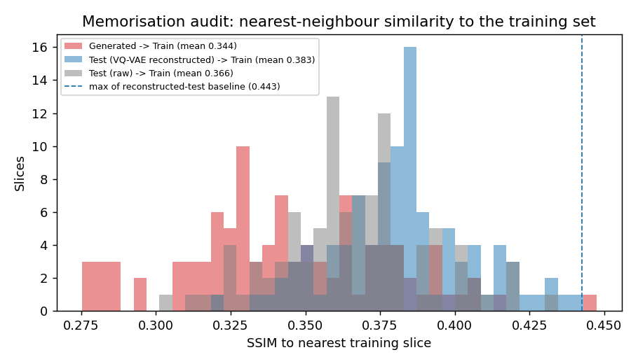
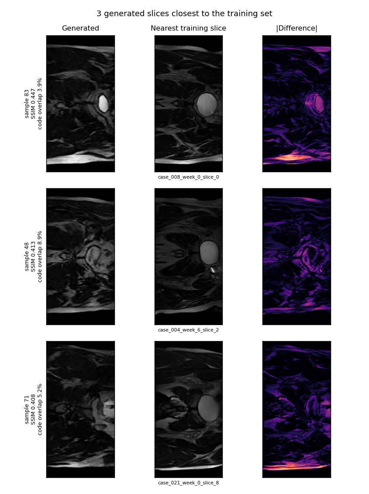
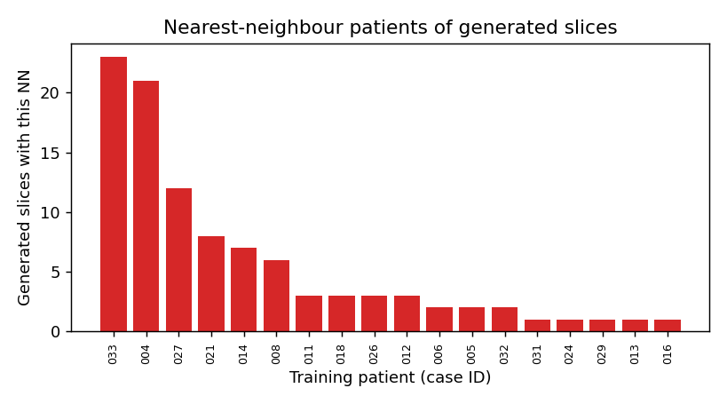

| Group (100 slices) | Mean NN-SSIM | Max NN-SSIM | Mean code overlap | Max code overlap | Distinct NN patients |
|---|---|---|---|---|---|
| Generated | 0.344 | 0.447 | 6.4% | 11.6% | 18 |
| Test (VQ-VAE reconstructed) | 0.383 | 0.443 | 8.4% | 11.2% | 21 |
| Test (raw) | 0.366 | 0.432 | 8.4% | 11.2% | 21 |

If samples were near-copies of training scans, sharing them could leak real patients' data. A realistic-looking sample could be new or copied, and this cannot be told by eye, so a memorisation audit was done to check whether the model copies its training data rather than learning from it. 100 samples were drawn from the final prior at T = 1.0, and each was compared by SSIM against all 11,460 training slices, keeping the nearest neighbour: its SSIM, its patient ID, and the percentage of identical codes. The baseline was 100 real test slices (unseen patients), both raw and passed through the VQ-VAE. The reconstructed baseline is the fair comparison, because generated slices also come out of the decoder. The results in the table show no evidence of memorisation. The generated mean nearest-neighbour (NN) SSIM is lower than for real unseen slices (0.344 vs 0.383), so generated slices are less similar to the training set than a new patient is, the opposite of what copying would look like. Only one sample (sample 83) was above the baseline maximum, by 0.004 (0.447 vs 0.443). However, the closest-slices figure shows it shares only the general layout (background, outline, skin band): its bladder has a different size and brightness, and only 3.9% of its codes match. Mean code overlap is lower than for real slices (6.4% vs 8.4%) and the maximum is similar (11.6% vs 11.2%), so about 94% of each sample's codes differ from every training slice. For comparison, VQ-VAE reconstructions of training slices score 0.908 mean / 0.949 max against the training set (Section 5, generation table), whereas the generated maximum of 0.447–0.478 (0.447 in this audit, 0.478 across the 300 samples in evaluate.py) is nowhere near it. This also confirms the search finds the right slice, since reconstructions score about as high as the VQ-VAE's normal reconstruction quality.

#### Patient analysis
The nearest matches came from 18 different patients, showing the model is not reproducing one or two people. However, the distribution is skewed: 033 (23), 004 (21) and 027 (12). Patient size is not the reason, since these three have 480 slices, like most other patients. Real test slices also match 004 and 027 often, so these are "hub" patients that resemble many slices. However, the model is partly responsible: 033 is far more common for generated slices (23 vs 7 for real), while real slices' most common matches, 012 and 032, rarely appear (3 and 2). This indicates the prior favours some body types and under-produces others. That is mild partial mode coverage, not memorisation, since code overlap stays low. Overall, these results show no evidence of copying, but the low similarity partly reflects the samples' remaining imperfections. Moreover, pixel-level SSIM can miss shifted copies, and the baseline is about 78% from one patient (040), so it is not fully representative.

### Latent interpolation
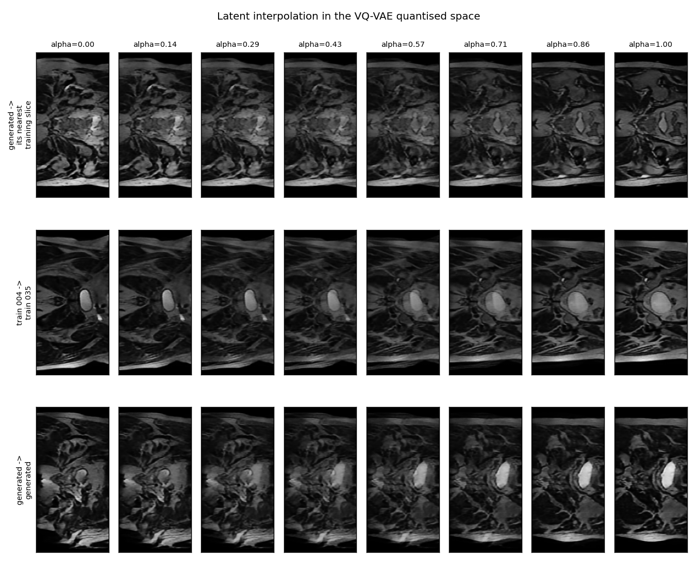

To test whether the model learned a generalised representation of the anatomy or simply memorised it, I interpolated between the latents of two slices. Since the VQ-VAE uses a discrete codebook, averaging the code grids directly is meaningless. Instead, I linearly interpolated between the quantised latents of two slices, z(α) = (1 − α)z_A + αz_B, bypassed the quantiser (as in the course VQ-VAE demo) and decoded each step. This was tested on three pairs: a generated slice and its nearest training slice, two training patients, and two generated slices. The transitions were smooth and every frame looked like an MRI slice: the bladder changed size and brightness gradually and the body outline stayed stable. This indicates a continuous latent space rather than retrieval of stored scans. Some frames had a cross-fade appearance, because the blended vectors fall between codebook entries, which the decoder never saw during training.

### Failure autopsy
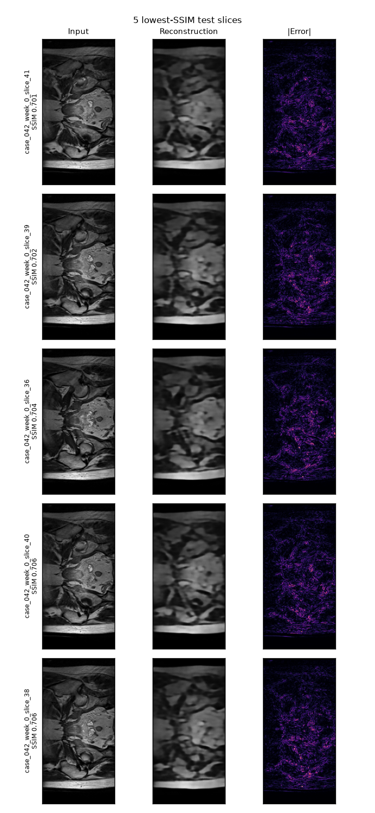

I examined four failure types, drawn from the lowest-SSIM reconstructions, the closest and most distorted generated samples, and the prior and temperature experiments.

1. **Fine texture in patient 042.** The worst reconstructions all come from patient 042, slices 36–41. The inputs have dense, bright, mottled texture, which the reconstruction smears into greyish regions. On the 32×16 model, SSIM drops to about 0.70, and the same region is 042's weakest on the 64×32 model too, suggesting the difficulty lies in this scan's content rather than one model. Each code represents an 8×8 (32×16) or 4×4 (64×32) pixel patch, so fine high-frequency texture cannot be represented exactly and is averaged out. This is a resolution limit of the codebook, which the 64×32 grid reduces.
2. **Horizontal black bands.** The bands in steps 1 and 4 persisted even at full receptive field. Convolutions apply the same weights at every position, so the prior could not tell an edge row (where background belongs) from a central one. Once it generated a background code mid-image, the codes to its left made background the most likely next code, so it continued across the row and into the rows below. Adding the position embedding removed the bands, which confirmed the cause.
3. **Smeared or ambiguous organs.** Some samples contain smeared or ambiguous regions and organs, such as sample 71 in the closest-slices figure. These remained after adding both depth and the position embedding. The likely cause is the PixelCNN's blind spot, which persists because the architecture itself was not changed. In addition, the PixelCNN makes 2,048 sequential decisions, so an early mistake carries through every later decision.
4. **Low-temperature collapse.** At lower temperatures, samples were darker and emptier, with less diverse structure and oversized bright blobs, because low T repeatedly selects the most likely codes, which are mostly background and dark tissue. This was avoided by sampling at T = 1.0.

### Recommendation to the project manager

**Overall, the synthetic scans should not yet be used as training data for downstream models. The model is privacy-safe by this audit and clearly outperforms the baseline, but its samples are not yet anatomically reliable.** It fully meets four of the five acceptance criteria from the feasibility review. It reconstructs slices with SSIM 0.917, outperforms the VAE baseline (SSIM 0.917 vs 0.506; FID 234 vs 421), and the memorisation audit found no evidence of copying training patients: generated slices are less similar to the training set than unseen real slices, and the closest sample (0.478) is far below the ~0.91 that near-copies score. It also avoids mode collapse: sample diversity (0.272) is close to real slices (0.225), unlike the VAE (0.519). The unmet criterion is anatomical plausibility. Although the samples have a coherent overall layout, many contain ambiguous organs, smeared regions and no clear bone structure. In its current form, it could support work on the generation and sharing pipeline itself, but it should not be shared as a substitute for real data or used to train diagnostic models. Before use, I would replace the PixelCNN with a blind-spot-free prior, repeat the memorisation audit in feature space to catch shifted copies, evaluate on more test patients, and have a clinician review sample plausibility.

## 7. Limitations and Future Work

The main limitations concern the prior's architecture, the evaluation, and the data. Each points to specific future work, ranked by expected impact on sample quality and reliability.

| Area | Limitation | Effect | Future work | Priority |
|---|---|---|---|---|
| **Prior** | Single-stack PixelCNN blind spot | Region above-right of each position is never seen, leaving smeared or ambiguous organs | Two-stack Gated PixelCNN | High |
| **Prior** | Local bias of convolutions | Long-range structure (left–right symmetry, bones) is hard to model | Attention-based prior (PixelSNAIL or transformer) | High |
| **Prior** | Errors compound over 2,048 sequential codes | One early mistake affects every later code | Hierarchical latents (VQ-VAE-2) so global structure is modelled first | Medium |
| **Evaluation** | Audit uses pixel-level SSIM | Could miss shifted or edited copies: in the planted-copy check (Section 9), a small brightness change alone lowered a copy's SSIM from 1.0 to 0.80 | Feature-space memorisation audit | High |
| **Evaluation** | Plausibility judged by eye | No expert confirmation of anatomy | Clinician review of samples | High |
| **Data** | Test set 78% one patient; 4 validation patients | Metrics mostly reflect patient 040 | More test patients or patient-level cross-validation | Medium |
| **Data** | 2D slices only | No consistency across neighbouring slices | 3D or slice-conditioned generation | Low |
| **Reconstruction** | MSE loss only; small decoder | Fine texture is smoothed (failure 1) | L1 + SSIM loss; extra decoder convolution\* | Low |

\* *Considered but not attempted: both require retraining the VQ-VAE and prior and repeating all evaluation, and training directly on SSIM would inflate the reported SSIM.*

Replacing the PixelCNN prior is the most direct route to more anatomically reliable samples, since the remaining problems are consistent with its blind spot and local bias. Before any use, the memorisation audit should also be repeated in feature space and the samples reviewed.


## 8. Usage

### Dependencies

Developed locally on Windows 11 (RTX 2050, 4 GB). The final PixelCNN prior and `evaluate.py` were run on Google Colab (A100).

| Package | Version | Used by |
|---|---|---|
| Python | 3.14.4 | all |
| torch | 2.14.1 (CUDA 13.2) | all |
| nibabel | 5.4.2 | `dataset.py` |
| numpy | 2.5.2 | all |
| scipy | 1.18.1 | `evaluate.py` (Fréchet distance) |
| matplotlib | 3.11.2 | figures |
| tqdm | 4.70.1 | progress bars |
| scikit-image | 0.26.0 | `check.py ssim` only |
| torchmetrics[image] | (Colab version) | `evaluate.py` Inception FID only (optional) |

```bash
pip install torch nibabel numpy scipy matplotlib tqdm scikit-image
pip install "torchmetrics[image]"   # optional, for Inception FID
```

### Reproducing the results

`<path>` is the folder containing `keras_slices_train`, `keras_slices_validate` and `keras_slices_test`.

```bash
# 1. Data audit (slice counts, shapes, patient overlap)
python dataset.py --data_root <path>

# 2. VAE baseline and VQ-VAE (64x32 code grid)
python train.py --model vae   --data_root <path> --epochs 20
python train.py --model vqvae --data_root <path> --epochs 15

# 2b. Optional: coarser 32x16 VQ-VAE used in Section 6
python train.py --model vqvae --data_root <path> --epochs 12 --n_down 3

# 3. Final PixelCNN prior (60 gated blocks, 64 channels, position embedding).
#    Needs more than 4 GB of VRAM; trained on a Colab A100.
python train.py --model prior --data_root <path> --vqvae_ckpt outputs/vqvae/best.pt \
    --prior_channels 64 --prior_blocks 60 --prior_pos --epochs 10

# 4. Reconstructions, per-slice and per-patient SSIM, best/worst cases, samples
python predict.py --data_root <path> --vqvae_ckpt outputs/vqvae/best.pt \
    --prior_ckpt outputs/prior/best.pt --n_samples 100 --temperature 1.0

# 5. Memorisation audit (nearest-neighbour SSIM, code overlap, patients)
python audit.py --data_root <path> --vqvae_ckpt outputs/vqvae/best.pt \
    --prior_ckpt outputs/prior/best.pt --n_samples 100 --n_test 100

# 6. Baseline vs VQ-VAE generation metrics and latent interpolation
python evaluate.py --data_root <path> --vqvae_ckpt outputs/vqvae/best.pt \
    --prior_ckpt outputs/prior/best.pt --vae_ckpt outputs/vae/best.pt --n_samples 300

# 7. Verification checks (results in Section 9)
python check.py shapes
python check.py causal
python check.py frechet
python check.py ssim
python check.py smoke
python check.py planted --data_root <path>
python check.py repro --train_json outputs/vqvae/results.json --predict_json outputs/predict/predict_results.json
```

**Reproducibility notes**
- All scripts use a fixed seed (`--seed 42`).
- Each checkpoint stores its hyperparameters (code-grid size, prior width/depth, position embedding), so `predict.py`, `audit.py` and `evaluate.py` rebuild the right architecture without extra flags.
- The VQ-VAE reached the same test SSIM (0.9174) on the RTX 2050 and the A100. GPU nondeterminism can still shift other numbers slightly between runs.
- Checkpoints and the dataset are not committed (size and data licence). Run the commands above to regenerate them.

### Project structure

| File | Purpose |
|---|---|
| `dataset.py` | Nifti loading, min-max scaling, patient-level splits, data audit |
| `modules.py` | VAE, VQ-VAE (encoder, vector quantiser, decoder) and gated PixelCNN prior |
| `train.py` | Training, validation and testing for `vae`, `vqvae` and `prior` |
| `predict.py` | Inference: reconstructions, per-slice and per-patient SSIM, code maps, sampling |
| `audit.py` | Memorisation audit: SSIM nearest neighbours, code overlap, nearest-neighbour patients |
| `evaluate.py` | VAE vs VQ-VAE generation: FID, Fréchet distance, diversity, NN-SSIM, interpolation |
| `check.py` | Shape, causality, metric, smoke, planted-copy and reproducibility checks |
| `utils.py` | SSIM, checkpoint save/load, plotting helpers |
| `figures/` | Images used in this README |

## 9. Artificial Intelligence Usage Disclosure

**Tool:** Claude (Anthropic), used conversationally throughout the project. No other AI tools were used.

### What the AI did

| Item | AI contribution |
|---|---|
| `dataset.py`, `modules.py`, `train.py`, `utils.py` | Generated the code. The vector quantiser follows the COMP3710 VQ-VAE MNIST demo; Claude added perplexity tracking and dead-code resets. |
| `predict.py` | Generated the code from features I asked for (best and worst 5 slices, per-patient SSIM, temperature sampling). |
| `audit.py` | Generated the code from the audit steps I specified (nearest-neighbour SSIM, code overlap, patient analysis, test baseline). |
| `evaluate.py` | Generated the code for the baseline vs VQ-VAE comparison and the interpolation. |
| `check.py` | Proposed the seven verification checks after I asked how to verify the pipeline, and wrote the code. |
| Debugging | Diagnosed errors I hit (VAE KL explosion, a removed SciPy argument, Colab path problems, a Windows encoding crash) and suggested fixes. |
| Prior fixes | When the 60-block samples looked worse despite a better likelihood, explained the receptive-field limit and suggested the position embedding. |
| Concepts | Explained VQ-VAE, PixelCNN masking and the blind spot, SSIM, FID and memorisation auditing as I worked. |
| Writing | Drafted the feasibility review from my results; drafted Section 8, the Section 9 verification table and the Section 10 references; reviewed my drafts of the other sections, corrected technical errors and fixed typos and wording. |

Each code file starts with a header stating its AI use.

### What I did

- Chose the task (VQ-VAE, Hard), the user and dilemma framing, and the VAE baseline.
- Set up and ran all data audits, training and evaluation on my laptop (RTX 2050) and Google Colab (A100), after the Rangpur queue proved too slow.
- Inspected the samples after every run and decided what to try next: the coarser 32×16 grid, a deeper and thinner prior, scaling to 60 blocks, then testing the position embedding on 32×16 before the final 64×32 model.
- Proposed and tested the sampling-temperature hypothesis, and rejected it when the samples got worse.
- Specified what the memorisation audit should measure and how its baseline should work, and chose to report the best and worst cases and per-patient results.
- Interpreted all results, including the patient-hub analysis, the failure autopsy and the recommendation.
- Wrote Sections 1 and 3–7 in my own words, then revised them after Claude's review.

### How I verified

I could not have written the checks in `check.py` myself, so I treated them as a second line of evidence. Most of my verification was hands-on:

- I inspected samples after every change, and rejected the 60-block prior even though it had the best likelihood, because its samples were visibly worse (Section 6, step 4).
- I tested my own temperature hypothesis and rejected it on the evidence (step 7).
- I confirmed that `predict.py` reproduced the training test SSIM (0.9174) on two different GPUs.
- I compared the audit's closest sample (sample 83) with its nearest training slice by eye: a different bladder size and brightness, not a copy.
- I checked that the most frequent nearest-neighbour patients had normal slice counts before attributing the skew to the model.
- I confirmed the patient split from the data audit and noticed that patient 040 makes up 78% of the test set.

The automated checks in `check.py` were written by Claude; I asked how to verify then proposed it. I ran all seven on my laptop and interpreted the results:

| Check | What it tests | Result |
|---|---|---|
| shapes | Every model maps a 1×256×128 slice back to 1×256×128, with the expected latent and code-grid sizes | PASS: VAE latent 256-d; VQ-VAE code grids 64×32 (`n_down` 2) and 32×16 (`n_down` 3) with valid indices 0–511; prior outputs 512 logits per position |
| causal | Changing one code (row 20, column 10) never changes predictions above or to its left | PASS: change above and at/left exactly 0, with and without the position embedding; positions to the right do change (0.107 / 0.066), so the code is used. Measured receptive field 9 rows for 6 blocks, matching 3 + N |
| frechet | My Fréchet distance against SciPy's formula | PASS: 33.3742 vs 33.3742; two sets from the same distribution give 0.145 (near 0) |
| ssim | My SSIM against scikit-image's | PASS: identical images give 1; differences of 0.0003, 0.0031 and 0.0124 at high, medium and low similarity, caused by edge handling (zero-padding vs skipped border) |
| smoke | Every script runs end to end on a small fake Nifti dataset | First run FAILED: `evaluate.py` crashed on Windows printing its table (cp1252 cannot encode "↓"), which my Colab runs had not shown. After forcing UTF-8 output, all scripts PASS and all 10 expected output files are created |
| planted | The memorisation audit finds training slices hidden among its queries | Exact copy: correct slice found, SSIM 1.000. Random noise: 0.016. Altered copy (0.9× contrast, +0.05 brightness): **correct slice found**, but SSIM was 0.805, so it failed the check's 0.9 threshold. The brightness shift lowers SSIM sharply in the dark background. 0.805 is still far above the generated (0.447) and unseen-patient (0.443) maxima, so such a copy would be flagged, but it shows pixel SSIM understates edited copies (Section 7) |
| repro | `predict.py` reproduces the test SSIM saved by `train.py` from the saved checkpoint | PASS for both models: 64×32 0.9174 vs 0.9174; 32×16 0.7775 vs 0.7775 |

## 10. References
1. A. van den Oord, O. Vinyals and K. Kavukcuoglu, "Neural Discrete Representation Learning," NeurIPS, 2017. arXiv:1711.00937
2. A. van den Oord, N. Kalchbrenner and K. Kavukcuoglu, "Pixel Recurrent Neural Networks," ICML, 2016. arXiv:1601.06759
3. A. van den Oord et al., "Conditional Image Generation with PixelCNN Decoders," NeurIPS, 2016. arXiv:1606.05328
4. Z. Wang, A. C. Bovik, H. R. Sheikh and E. P. Simoncelli, "Image Quality Assessment: From Error Visibility to Structural Similarity," IEEE Trans. Image Processing, 13(4), 600–612, 2004.
5. COMP3710 course materials, University of Queensland, 2026: VQ-VAE MNIST demo and Lecture 7 (CNNs).
